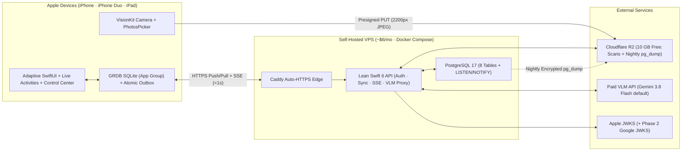

# Blythe's Life — Initial PRD & Technical Architecture

> **Status:** Discovery, Market Research, UX Prototyping & Architecture **Complete** → Ready for **Phase 1 (MVP) Implementation**  
> **Target Platforms:** Universal Apple App — **iPhone**, **iPhone Duo** (folded, unfolded hinge-aware, and half-folded tabletop), and **iPad** (iOS / iPadOS 27, Swift 6.4)  
> **Operating Cost Target:** ~$6/mo VPS + ~$0.60/mo Paid VLM API + $0/mo Cloudflare R2 Free Tier *(plus $99/yr Apple Developer Program)*

---

## Repository Structure & Running Locally

```text
blythes-life/
├── design-system/   # Canonical Design System (OKLCH tokens, Day/OLED Night, components, interactive UI kit)
├── shared/          # BlythesLifeShared — pure Swift 6 models, sync DTOs, VLM schemas & domain logic
└── ios/             # Universal SwiftUI app for iPhone, iPhone Duo, and iPad
    ├── BlythesLife.xcodeproj   # Universal iOS/iPadOS Xcode project (Swift 6 strict concurrency)
    ├── BlythesLifeApp/         # App entry point, Info.plist, and Assets.xcassets
    └── BlythesLifeAppKit/      # Local SwiftPM package: BlythesLifeDesignSystem, BlythesLifeCore, BlythesLifeUI
```

> **Private Backend Repository:** The self-hosted Swift 6 API server, Docker Compose stack, OpenTofu IaC, and SOPS-encrypted secrets live in the separate private **`blythes-life-backend`** repository. Private real-world paper log fixtures are never committed to git.

### Quick Start

```bash
# 1. Run pure Swift 6 shared model & domain tests
swift test --package-path shared

# 2. Run iOS kit unit tests (Design System & Core)
swift test --package-path ios/BlythesLifeAppKit

# 3. Build the universal iOS/iPadOS app for iOS Simulator (no signing team required)
xcodebuild -project ios/BlythesLife.xcodeproj \
  -scheme BlythesLife \
  -destination 'generic/platform=iOS Simulator' \
  build

# Or open directly in Xcode to run on Simulator / Device:
open ios/BlythesLife.xcodeproj
```

---

## 1. Product Vision & Goals

**Blythe's Life** is a fast, calm, offline-first family baby-tracking app built around two core goals:

1. **Under-3-Second One-Handed Daily Logging:** Instant 0ms offline logging at 3 AM or on airplanes, synced in `<1s` across every family Apple device (parents' iPhones / iPhone Duo and a nursery/counter iPad) with zero upsells, ads, or clutter.
2. **Effortless Caregiver Paper-to-Log Capture:** Blythe's weekday caregiver (Grandma) writes daily care updates on paper sheets whose layout evolves over time as Blythe grows. Parents snap a photo (or import a texted photo) → layout-agnostic multimodal AI extracts structured events → parents verify in an adaptive split-screen **Review & Confirm UI** → batch save & sync.

### Explicit Non-Goals (Scope Cuts)
- **No Personal Adult Food Diary:** Meals log directly on Blythe's profile (no private-vs-shared adult profile sharing or `profile_shares` RLS complexity).
- **No Printable Sheet / PDF / AirPrint / QR Generation:** Picture scan only — zero QR code dependency or rigid paper templates.
- **No SaaS Vendor Lock-In:** Standard self-hosted PostgreSQL 17, lossless JSON + CSV export, and Huckleberry CSV import so the family owns 100% of its data.

---

## 2. MVP Feature Requirements (Phase 1)

### 2.1 Daily Care Tracking & Home Experience
- **"Time Since Last…" Glance Strip:** Always-visible top summary showing elapsed time **Awake**, **Last Bottle**, and **Last Diaper** (inspired by Nara Baby).
- **Asymmetric "Mini SweetSpot" Wake-Window Predictor:** Local on-device next-nap countdown supporting asymmetric per-nap wake windows (e.g., `2½h` before Nap 1, `3¼h` before Nap 2, `90m` nap cap, short-nap reset, backup catnap cutoff), editable in Settings as Blythe's schedule evolves.
- **One-Handed 6-Action Quick Grid (OLED Night-Friendly):** Compact 2×3 thumb grid (inspired by PiyoLog) covering every care event:
  1. **Sleep:** Shared live Nap / Night Timer (syncs active state across devices) + manual start/end range.
  2. **Feeding / Bottles:** Free **arbitrary decimal numeric input** (enter any exact number, e.g. `3.25 oz` or `85 mL`) with `oz` / `mL` unit switch, quick-tap presets, `Formula` / `Breast Milk` / `Mixed` selector, and optional `+ Vitamin D` companion checkbox. Stored canonically as `amount_ml` + `display_unit`.
  3. **Diapers:** One-tap `PEE` (`S` / `M` / `L` / none) and `POOP` (`S` / `M` / `L` / none) selectors + optional notes/rash flag.
  4. **Meals / Solids (Blythe):** Meal slot (`breakfast` | `lunch` | `dinner` | `snack`), timestamp, optional free-text notes ("what she ate"), and optional `NONE` / `SOME` / `MOST` amount selector.
  5. **Bath:** Explicit **`Shampooed Hair?` (`Yes` / `No`)** toggle (`washed_hair: true | false`) + optional notes.
  6. **Meds & Care:** Generalized logger (not limited to Vitamin D) with quick-pick chips (`Vitamin D`, `Infant Tylenol`, `Butt Cream`, `Saline Drops`, `Gas Drops`, `Custom`), category (`medicine` | `supplement` | `topical`), **arbitrary decimal dose** + unit (`mL` | `drops` | `mg` — optional/omitted for topical care like butt cream), and optional notes.
  7. **Notes:** Free-text daily notes (manual or imported from sheet footer).

### 2.2 Layout-Agnostic Picture-Scan OCR (Core Differentiator)
- **Capture:** `VNDocumentCameraViewController` (auto-crop & deskew) + `PhotosPicker` (for caregiver-texted photos and iOS Simulator testing). Images resized to `~2200 px` long edge (~500–700 KB JPEG) for sharp legibility on iPad & iPhone Duo.
- **Evolving-Layout VLM Extraction:** Prompt + strict JSON Schema adapt semantically to *any* daily log format (e.g., Nov 18 sheet, Nov 25 sheet, future 1-nap sheets, or handwritten notepads):
  - **Target vs. Actual Isolation:** Strictly ignores planned `TARGET` columns, handwritten target adjustments (e.g., `9:30–11`), target oz ranges (e.g., `2–4 oz`), and static caregiver instruction boxes.
  - **Dynamic Row Labels:** Reads per-row badges live (`FORMULA`, `+ VIT D`, `PEE/POOP S/M/L`, `NONE/SOME/MOST`) regardless of row ordering.
  - **Real-World Handwriting Safeguards:** Parses fractions (`2½` → `2.5 oz`), ignores scratched-out entries, resolves AM/PM via caregiver daytime window + chronological order, and flags unclear digits (`confidence: "medium" | "low"` + `ambiguity_reason` + normalized bounding box).
  - **Incremental Re-Scan Deduplication:** API loads existing events for `(profile_id, scan_date)` so midday + evening scans return `match_action: "create" | "skip_duplicate" | "update_existing"`, backed by a deterministic ±15 min client check.
- **Adaptive Split-Screen Review & Confirm UI (Never Auto-Commits):**
  - **iPhone / Duo Folded:** Stacked top 38% zoomable photo / bottom 62% editable draft cards.
  - **iPhone Duo Unfolded (7.6") & iPad:** Side-by-side left zoomable sheet / right draft cards respecting the physical fold crease (`GeometryProxy.reservedRegions(kind: .division)`).
  - Tap any card to highlight/zoom that region, resolve amber ambiguity chips, toggle duplicate skips, and confirm optional Vitamin D suggestions triggered by `+ VIT D` badges.

### 2.3 Adaptive Multi-Device & Native Apple MVP Features
- **PiyoLog-Style 7-Day Vertical 24-Hour Rhythm Strip:** Dedicated `Rhythm` tab on iPhone and side-by-side companion pane on unfolded iPhone Duo / iPad; plots Sleep blocks, Formula vs. Breast Milk bottles, Meals, and Diapers vertically by clock hour with tappable daily totals.
- **Shared Lock Screen Live Activities & iOS Control Center:** Active shared nap timer on Lock Screen / Dynamic Island (`Wake Up` interactive button) and Control Center quick-log tiles reading/writing the shared App Group GRDB SQLite database.
- **iPhone Duo Half-Folded Tabletop Nightstand Mode:** Top propped half displays live nap timer / Mini SweetSpot / elapsed counters; horizontal hinge safe-zone separates giant sleepy-thumb bottom controls (`Start/Wake Nap`, `Log Bottle`, `Log Diaper`).

### 2.4 Data Portability & Migration
- **Huckleberry CSV Importer:** Parses Huckleberry's 8–9 column CSV export into `events` with deterministic `external_id = "hb:" + sha256(...)` so overlapping re-imports never duplicate Blythe's 8-month history.
- **1-Tap Lossless JSON Bundle Export:** Full re-importable `v1` export via iOS `ShareLink` (Files / iCloud Drive / AirDrop).
- **Per-Profile CSV Export:** Clean flattened human/pediatrician-readable CSV export.

---

## 3. Technical Architecture (100% Swift 6 End-to-End)

### 3.1 Stack Decisions

| Layer | Locked Decision | Rationale |
| :--- | :--- | :--- |
| **Apple Client** | **Universal SwiftUI (Swift 6.4, iOS 27, Xcode 27.2)** | Single binary for iPhone, iPhone Duo (`reservedRegions(.division)` hinge & tabletop), and iPad (`NavigationSplitView`). Zero hardcoded `UIScreen.main.bounds`. |
| **Shared Models** | **`BlythesLifeShared` SwiftPM Package** | Shares exact `Codable` domain models, sync DTOs, and VLM extraction schemas between iOS/iPad/Duo client and Linux VPS server — zero JSON drift. |
| **Local Offline Store** | **GRDB.swift (SQLite in App Group)** | Instant 0ms offline writes, atomic Domain + Outbox transactions, shared directly with WidgetKit / Live Activities / Control Center, protected with `completeUntilFirstUserAuthentication`. |
| **Backend Hosting** | **Self-Hosted VPS (Hetzner CX23, 4 GB RAM, ~$6/mo)** | Flat predictable cost, zero 7-day inactivity pause cliff, zero $25/mo SaaS jump. Runs a lean 3-container Docker Compose stack: **Caddy + Swift API + PostgreSQL 17**. |
| **API Server** | **Swift 6 (`Hummingbird 2` default / `PostgresNIO` / `jwt-kit`)** | Low memory footprint (~45–75 MB RAM), native structured concurrency for SSE fan-out, and shared SwiftPM models with the Apple app. |
| **Database** | **PostgreSQL 17 (Docker Volume)** | Open portable SQL (`pg_dump`), `JSONB`, `TIMESTAMPTZ`, partial unique indexes, and native `LISTEN/NOTIFY` for `<1s` multi-device SSE sync without Redis. |
| **Scans & Backups** | **Cloudflare R2 (10 GB Free, $0 Egress)** | Off-box durability for 2200px scan JPEGs (~430 MB/yr → 20+ yrs free) and nightly encrypted `pg_dump` archives. Abstracted behind a 30-line `BlobStore` interface (`local` in dev, `r2` in prod). |
| **AI / OCR VLM** | **Swappable Paid-Tier Adapter (`gemini-3.8-flash` default)** | Env-var swappable (`EXTRACTION_MODEL`) across `gemini-3.8-flash`, `gpt-4.1`, and `claude-sonnet-5-5`. **Paid API tier only** (opts out of training). All API keys live strictly on the VPS. |
| **Auth (MVP → Ph 2)** | **Native Sign in with Apple (JWKS + `.p8` revoke ready)** | Zero Auth SaaS cost. Verifies Apple RS256 JWKS + nonce and exchanges `authorizationCode` via `.p8` key to store encrypted Apple refresh token for App Store Guideline 5.1.1(v) account deletion. **Google Sign-In** plugs into `user_identities` in Phase 2 (~40 LOC, zero migration). |
| **Distribution** | **Apple Developer ($99/yr) → TestFlight Internal** | Instant OTA updates to family devices with optional path to Unlisted App Store later. |

### 3.2 System Topology



### 3.3 Offline-First Sync Protocol
- **Write Path:** Every create/update/soft-delete commits the domain row and an `outbox` mutation in one local GRDB transaction (`0ms` UI latency) with a client-generated UUID.
- **Push:** `SyncEngine` flushes outbox entries idempotently via `POST /v1/sync/push` (`ON CONFLICT (id)` using LWW `updated_at`).
- **Realtime + Recovery:** Postgres triggers `NOTIFY household_<id>` → Swift API fans out over SSE (`GET /v1/sync/stream`) to every connected device (`<1s` updates across iPhone Duo, spouse's iPhone, and iPad). App launch, foreground resume, and offline→online reconnect (`NWPathMonitor`) run watermark delta pull (`GET /v1/sync/pull?since=<watermark>`).

---

## 4. Simplified Data Model (8 PostgreSQL Tables)

1. `users (id UUID PK, display_name, primary_email, created_at, deleted_at)`
2. `user_identities (id UUID PK, user_id FK, provider ['apple'|'google'], provider_sub, email, email_verified, apple_refresh_token_enc, created_at)` — `UNIQUE(provider, provider_sub)`
3. `refresh_tokens (id UUID PK, user_id FK, token_hash UNIQUE, device_id, device_name, platform, expires_at, revoked_at, created_at)` — 1 row per device so iPhone Duo, iPad, and spouse's iPhone stay signed in simultaneously
4. `households (id UUID PK, name, invite_code, invite_expires_at, created_by, created_at)`
5. `household_members (household_id FK, user_id FK, role ['owner'|'member'|'caregiver'], display_name, PRIMARY KEY (household_id, user_id))`
6. `profiles (id UUID PK, household_id FK, display_name, birth_date, default_timezone, schedule_config JSONB, created_at, updated_at, deleted_at)` — Blythe now; extensible for siblings. `schedule_config` stores asymmetric wake windows (e.g. `[150, 195]`), nap cap (`90`), and backup catnap rules.
7. `paper_scans (id UUID PK, profile_id FK, scan_date DATE, timezone TEXT, storage_key TEXT, model_id TEXT, raw_extraction JSONB, sheet_notes TEXT, status ['pending_review'|'confirmed'|'discarded'], scanned_by FK, created_at, updated_at)`
8. `events (id UUID PK client-generated, profile_id FK, event_type ['sleep'|'feeding'|'diaper'|'meal'|'bath'|'medicine'|'note'], started_at TIMESTAMPTZ, ended_at TIMESTAMPTZ, timezone TEXT, notes TEXT, metadata JSONB, source ['manual'|'paper_scan'|'import_huckleberry'|'control_center'], scan_id FK, external_id TEXT, created_by, updated_by, created_at, updated_at, deleted_at)`

### Canonical `events.metadata` Conventions
- `sleep`: `{ "sleep_type": "nap" | "night", "location": "crib" | "stroller" | "contact" | null }`
- `feeding`: `{ "method": "bottle" | "breast", "substance": "breast_milk" | "formula" | "mixed", "amount_ml": 88.7, "display_unit": "oz" | "ml" }`
- `diaper`: `{ "pee_size": "S" | "M" | "L" | null, "poop_size": "S" | "M" | "L" | null, "rash": false }`
- `meal`: `{ "meal_slot": "breakfast" | "lunch" | "dinner" | "snack" | null, "portion_eaten": "none" | "some" | "most" | null }`
- `bath`: `{ "washed_hair": true | false }`
- `medicine`: `{ "name": "Vitamin D" | "Infant Tylenol" | "Butt Cream" | ..., "category": "medicine" | "supplement" | "topical", "dose": 2.5 | null, "unit": "ml" | "drops" | "mg" | null }`

---

## 5. Golden OCR Evaluation Fixtures (Kept Private Outside Git)

Two real-world paper log examples sit outside this git repository for local VLM eval testing (never committed to git history):
1. **`../IMG_0009.jpg` (Nov 18 midday photo):** Tests flat 3h schedule, Row 1 `+ VIT D` breast milk (`2½ oz`), scratched-out `11:05` beneath `11:00`, ambiguous overwritten `11:20`/`11:30` diaper time (`PEE L`), and 6 handwritten `TARGET` edits that MUST yield 0 phantom events.
2. **`../Blythe's Daily Log.pdf` (Nov 25 evolved sheet):** Tests asymmetric wake windows (`2½h / 3¼h`), dynamic pill repositioning (`FORMULA` on Rows 1 & 3 with `2–4 oz` target ranges; `+ VIT D` moved to Row 2 breast milk), and Lunch shifted to `12:00`.

---

## 6. Phased Roadmap

### Phase 1 — MVP (Current Build Target)
- Shared SwiftPM `BlythesLifeShared` package + Swift 6 VPS backend (`Docker Compose`: Caddy + Hummingbird 2 API + PostgreSQL 17 + `BlobStore` local/R2 + encrypted `pg_dump` backup script).
- Native Sign in with Apple (JWKS + `.p8` refresh token storage + per-device sessions) & Household 6-digit invite pairing.
- Universal iOS 27 SwiftUI app (iPhone, iPhone Duo hinge-aware & half-folded Tabletop mode, iPad `NavigationSplitView`) + GRDB App Group local SQLite + Outbox/Watermark/SSE sync.
- Full daily care & meal logging (arbitrary numeric entry, Bath shampoo toggle, generalized Meds/Care), Time-Since-Last strip, asymmetric Mini SweetSpot, PiyoLog 7-Day Vertical Rhythm Strip, and Shared Live Activities + iOS Control Center.
- Layout-agnostic Picture-Scan OCR (`gemini-3.8-flash` default) + Adaptive Split-Screen Review & Confirm UI + local OCR eval harness.
- Huckleberry CSV Importer + 1-tap Lossless JSON & CSV Export → TestFlight Internal family rollout.

### Phase 2 — Fast Follow Polish
1. **iOS Share Extension:** Long-press any midday sheet photo or text message Grandma sends in iMessage → Share → *Blythe's Life* → feeds straight into VLM Review UI.
2. **Blythe's "Tried / Safe Foods" Quick-Tap Chips & Allergen Watch:** Track introduced solids & 3-day allergen trials with a 1-tap shareable safe-foods list for Grandma.
3. **$0.30 Passive NFC Stickers + Siri `AppIntents`:** Hands-free tap logging on crib/changing pad and Siri voice logging.
4. **Optional 1-Tap Photo Attachment on Blythe's Meals:** Reuses Cloudflare R2 upload pipeline.
5. **1-Tap Pediatrician Checkup & Babysitter Handoff Card:** 7-day rolling averages (sleep, milk oz, wet/dirty diapers) + shareable summary.
6. **Google Sign-In:** Add `POST /v1/auth/google` (~40 LOC) + explicit "Link Google Account" in Settings (safely handling Apple Private Relay emails).
