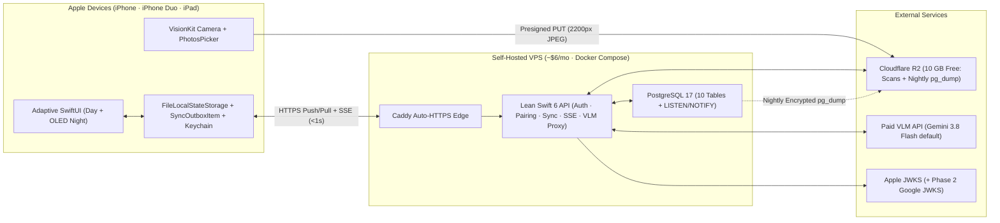

# Blythe's Life — PRD & Technical Architecture

> **Status:** **MVP Live on TestFlight Internal** (Universal Apple App + Self-Hosted Swift 6 Backend)  
> **Target Platforms:** Universal Apple App — **iPhone**, **iPhone Duo** (folded, unfolded hinge-aware, and half-folded tabletop), and **iPad** (iOS / iPadOS 27, Swift 6.4)  
> **Operating Cost Target:** ~$6/mo VPS + ~$0.60/mo Paid VLM API + $0/mo Cloudflare R2 Free Tier *(plus $99/yr Apple Developer Program)*

---

## Repository Structure & Running Locally

```text
blythes-life/
├── design-system/   # Canonical Design System (OKLCH tokens, Day/OLED Night, components, interactive UI kit)
├── shared/          # BlythesLifeShared — pure Swift 6 models, sync DTOs, VLM schemas & domain logic
└── ios/             # Universal SwiftUI app for iPhone, iPhone Duo, and iPad
    ├── BlythesLife.xcodeproj   # Universal iOS/iPadOS Xcode project (Swift 6 strict concurrency)
    ├── BlythesLifeApp/         # App entry point, Info.plist, and Assets.xcassets
    └── BlythesLifeAppKit/      # Local SwiftPM package: BlythesLifeDesignSystem, BlythesLifeCore, BlythesLifeUI
```

> **Private Backend Repository:** The self-hosted Swift 6 API server, Docker Compose stack, OpenTofu IaC, and SOPS-encrypted secrets live in the separate private **`blythes-life-backend`** repository. Private real-world paper log fixtures are never committed to git.

### Quick Start

```bash
# 1. Run pure Swift 6 shared model & domain tests
swift test --package-path shared

# 2. Run iOS kit unit tests (Design System & Core)
swift test --package-path ios/BlythesLifeAppKit

# 3. Build the universal iOS/iPadOS app for iOS Simulator (no signing team required)
xcodebuild -project ios/BlythesLife.xcodeproj \
  -scheme BlythesLife \
  -destination 'generic/platform=iOS Simulator' \
  build

# Or open directly in Xcode to run on Simulator / Device:
open ios/BlythesLife.xcodeproj
```

---

## 1. Product Vision, Goals & Non-Functional Requirements

**Blythe's Life** is a fast, calm, offline-first family baby-tracking app built around four core goals and architectural principles:

1. **Under-3-Second One-Handed Daily Logging:** Instant `0ms` offline writes at 3 AM or on airplanes, synced in `<1s` via Server-Sent Events (SSE) across every family Apple device (parents' iPhones, iPhone Duo, and a nursery/counter iPad) with calm warm-paper Day and true-black OLED Night themes, and zero ads, upsells, or clutter.
2. **Template-Free Caregiver Paper-to-Log Capture:** Blythe's weekday caregiver (Grandma) writes daily care updates on paper sheets or handwritten notepads whose layout evolves over time as Blythe grows. Parents snap a photo or import a texted image/PDF — with zero QR codes, AirPrint templates, or rigid layouts required — and layout-agnostic multimodal AI extracts structured events into an adaptive split-screen **Review & Confirm UI** before batch save & sync.
3. **Baby-First Household & Profile Model:** All daily care logs, schedules, SweetSpot predictors, and solid meals center directly on child profiles within an owner-approved family household, extensible for siblings.
4. **Full Data Ownership & Portability:** Self-hosted PostgreSQL 17, Cloudflare R2 media storage and encrypted nightly backups, 1-tap lossless JSON + pediatrician CSV export, and idempotent Huckleberry CSV import — ensuring 100% family data ownership with zero SaaS vendor lock-in.

---

## 2. MVP Feature Requirements (Phase 1 — Live on TestFlight Internal)

### 2.1 Daily Care Tracking, Home Experience, Event Classification & Smart Predictors

- **Hero Sleep Card & Glance Strip:** Always-visible Today summary pairing an elapsed **Awake / Sleeping** hero card with tappable `BLGlanceStat` cards (**Last Feed** with subtle SweetSpot progress rail & next-feed countdown, **Last Diaper**, and meal rhythm awareness), plus shared household live active-nursing & active-pump, pending-scan-review, and owner join-approval banners.
- **Shared Household Live Timers (Sleep, Nursing & Pump):** All three live timers sync in real time (`<1s` via SSE) across every household member's iPhone, iPhone Duo, and iPad using open `events` rows (`is_timer_active: true`, `ended_at: null`), so either parent can start, switch sides, pause/resume, or finish any active timer seamlessly from any device.
- **Smart Event Classification** *(answers "what is this event?" — cleanly separated from future rhythm prediction)*:
  - **Sleep (`Nap` vs. `Night sleep`) — 3-Zone + Duration Guard:** Anchored to configurable **Target Bedtime** (default `7:30 PM`): clearly night (`targetBedtime - 45m` through `6:00 AM`, always Night regardless of nap count), clearly daytime (`6:00 AM` through `targetBedtime - 2h 15m`), and context-aware twilight zone (`targetBedtime - 2h 15m` to `-45m` checking backup catnap cutoff, nap count, and awake stretch). Past sleeps `>= 3.5h` or crossing midnight auto-classify as Night; late naps running past `napCap + 60m` offer a calm 1-tap `"Switch to night sleep?"` prompt; manual selection always wins.
  - **Meal Slots (`Breakfast` / `Lunch` / `Snack` / `Dinner`):** Clock-time and morning-wake anchored (Breakfast `5:00–10:29 AM` extending up to `morningWake + 2h 30m` capped at `11:15 AM`; Lunch `10:30 AM–2:29 PM` with duplicate-lunch → Snack; Snack `2:30–4:29 PM`; Dinner `4:30 PM+`). Never inferred by meal count (a single meal at 5:00 PM is always Dinner). Live-updates as the user adjusts the time picker until overridden.
- **Mini SweetSpot Predictors** *(answers "what comes next?")*:
  - **Naps & Dynamic Bedtime:** Flexible **1–4 naps/day** with asymmetric per-nap wake windows (e.g., `2½h` before Nap 1 and `3¼h` before Nap 2, with age-sensible presets for 1–4 naps), nap-count-aware **bedtime wake window** (e.g., `3¾h` for 2 naps, `5¼h` for 1 nap), per-nap duration cap (`90m`), short-nap reset (`<45m` resets next wake window to `2½h`), backup catnap cutoff (`5:00 PM`, `25m` cap), and smooth evening transition to Bedtime.
  - **Milk Feeds (Bottles & Nursing):** Configurable daytime interval (default `3h`) with a live SweetSpot countdown and subtle progress rail on Today, **Bedtime feed cap** (`targetBedtime - 30m` so evening feeds aren't pushed past bedtime), overnight suppression during Night sleep, and honest `"Light feed · may want more soon"` cue for `< 1.5 oz` bottles (without nearby solids) or `< 3m` nursing sessions instead of fragile volume-guessing math.
  - **Solid Meals:** Configurable **1–3 daily meal windows** (default `8:30 AM`, `12:30 PM`, `5:30 PM`), slot-based completion, 90-minute missed-slot rollover, optional feed-to-meal spacing (`Off` or `15m–120m`, default `45m`), and calm `"Waiting until after nap"` state when baby is currently asleep.
- **One-Handed 4×2 Quick-Log Dock & Hero Sleep Timer (OLED Night-Friendly):** Thumb-reachable bottom dock paired with the hero sleep card covering all **8 canonical event types** (`sleep`, `feeding`, `pump`, `diaper`, `meal`, `bath`, `medicine`, `note`):
  1. **Sleep (`sleep`):** Shared live Nap / Night Timer (syncs active state in real time across household devices, auto-classifies Nap vs. Night using the Target Bedtime 3-zone rules, and offers a 1-tap `"Switch to night sleep?"` prompt on long late naps) + manual start/end past-sleep entry (with `>= 3.5h` / overnight Night auto-guard) and optional location (`crib` | `stroller` | `contact`).
  2. **Bottle (`feeding` · `bottle`):** Free **arbitrary decimal numeric input** (enter any exact amount, e.g., `3.25 oz` or `85 mL`) with `oz` / `mL` unit switch, quick-tap presets, `Formula` / `Breast Milk` / `Mixed` selector, and optional `+ Vitamin D` companion checkbox. Stored canonically as `amount_ml` + `display_unit`.
  3. **Nursing (`feeding` · `breast`):** **Live mutually-exclusive dual-side L/R timer** (`BLNursingTimer` — tap Left/Right to start, switch sides seamlessly, pause/resume, synced in real time across household devices and persisted across app launches with an active Today banner) **plus unified Left & Right minute entry on a single pane** (eliminating the manual `Left`/`Right`/`Both` picker while auto-deriving `side` and prompting `Ended on` only when both sides have minutes), with cross-session `last_side` tracking (`Last` indicator & automatic opposite-side default) and lossless L/R editing, storing `left_duration_seconds`, `right_duration_seconds`, `side`, `last_side`, and `duration_minutes`.
  4. **Pump (`pump`):** **Simultaneous-default manual logger** (arbitrary decimal per-side `Left`/`Right` volume in `oz` / `mL` with a quick `Combined` toggle, and shared simultaneous duration with an optional `Different times per side` split) **plus an independent dual-side live Pump timer** (`BLPumpTimer` with `Start both`/`Pause both`, staggered stop, and union-of-active-intervals session duration, synced in real time across household devices and persisted across launches with an active Today banner), storing canonical `amount_ml`, `display_unit`, `duration_minutes`, and derived `side` plus optional `left_amount_ml`, `right_amount_ml`, `left_duration_seconds`, and `right_duration_seconds`.
  5. **Diaper (`diaper`):** One-tap `PEE` (`S` / `M` / `L` / none) and `POOP` (`S` / `M` / `L` / none) selectors, optional rash toggle, optional **poop color** (`yellow`, `brown`, `green`, `orange`, `black`, `red`, `pale`), optional **poop consistency** (`watery`, `runny`, `seedy`, `soft`, `firm`, `hard`, `mucousy`), and notes.
  6. **Meal (`meal`):** Clock-time and morning-wake-aware meal slot (`breakfast` | `lunch` | `dinner` | `snack`, live-updating as the time picker changes until overridden), timestamp, optional free-text notes ("what she ate"), and optional `NONE` / `SOME` / `MOST` portion selector.
  7. **Bath (`bath`):** Explicit **`Shampooed Hair?` (`Yes` / `No`)** toggle (`washed_hair: true | false`) + optional notes.
  8. **Meds & Care (`medicine`):** Generalized logger with quick-pick chips (`Vitamin D`, `Infant Tylenol`, `Butt Cream`, `Saline Drops`, `Gas Drops`, `Custom`), category (`medicine` | `supplement` | `topical`), **arbitrary decimal dose** + unit (`mL` | `drops` | `mg` — optional/omitted for topical care), and optional notes.
  9. **Note (`note`):** Free-text daily notes (manual or imported from paper sheet footers).
  - *Every timeline entry is tappable for full editing or soft-deletion with an instant Undo toast.*
- **Pump Notifications (Settings):** Configurable per-device local `UNUserNotificationCenter` pump interval reminders (e.g., every `2h–6h`), optional live timer target alerts, and optional quiet hours — scheduled entirely on-device without push server overhead.
- **Sign in with Apple Onboarding Gate & Sample Preview:** Clean blank first launch requiring **Sign in with Apple** → **Create Household** (household name, baby name, and birth date) or **Join with One-Time Code** (awaiting Owner approval), plus an optional local **"Explore with sample data"** preview mode for open-source contributors and reviewers. Device posture simulation controls are compiled strictly under `#if DEBUG`.

### 2.2 Layout-Agnostic Picture-Scan OCR (Core Differentiator)

- **Capture:** `VNDocumentCameraViewController` (auto-crop & deskew) + `PhotosPicker` (for caregiver-texted photos and iOS Simulator testing) + PDF import. Images resize to `~2200 px` long edge (~500–700 KB JPEG) for crisp legibility on iPad & iPhone Duo.
- **Evolving-Layout VLM Extraction:** Prompt + strict JSON Schema adapt semantically to *any* daily log format (multi-nap sheets, evolving 1-nap sheets, or handwritten notepads):
  - **Target vs. Actual Isolation:** Strictly ignores planned `TARGET` columns, handwritten target adjustments (e.g., `9:30–11`), target oz ranges (e.g., `2–4 oz`), and static caregiver instruction boxes.
  - **Dynamic Row Labels & Badges:** Reads per-row badges live (`FORMULA`, `+ VIT D`, `PEE/POOP S/M/L`, `NONE/SOME/MOST`) regardless of row ordering.
  - **Smart Sleep & Meal Slot Classification Rules:** Applies the canonical classification rules during extraction and review — sleep uses the Target Bedtime 3-zone + `>= 3.5h`/overnight duration guard (clearly night `targetBedtime - 45m` through `6:00 AM`, default `6:45 PM`–`6:00 AM`), and meal timestamps classify by clock time & morning-wake Breakfast anchor (`5:00–10:29 AM` extending up to `morningWake + 2h 30m` capped at `11:15 AM`, Lunch `10:30 AM–2:29 PM` with duplicate-lunch → Snack, Snack `2:30–4:29 PM`, Dinner `4:30 PM+`), never by meal count.
  - **Real-World Handwriting Safeguards:** Parses fractions (`2½` → `2.5 oz`), ignores scratched-out entries, resolves AM/PM via caregiver daytime window + chronological order, and flags unclear digits (`confidence: "medium" | "low"` + `ambiguity_reason` + normalized bounding box).
  - **Incremental Re-Scan Deduplication:** API loads existing events for `(profile_id, scan_date)` so midday + evening scans return `match_action: "create" | "skip_duplicate" | "update_existing"`, backed by a deterministic ±15 min client check.
- **Adaptive Split-Screen Review & Confirm UI (Never Auto-Commits):**
  - **iPhone / Duo Folded:** Stacked top 38% zoomable photo / bottom 62% editable draft cards.
  - **iPhone Duo Unfolded (7.6") & iPad:** Side-by-side left zoomable sheet / right draft cards respecting the physical fold crease (`GeometryProxy.reservedRegions(kind: .division)`).
  - Tap any card to highlight/zoom that region, resolve amber ambiguity chips (save stays locked until every included ambiguity is resolved), toggle duplicate skips, and confirm optional Vitamin D suggestions triggered by `+ VIT D` badges.

### 2.3 Adaptive Multi-Device & 7-Day Rhythm Strip

- **PiyoLog-Style 7-Day Vertical 24-Hour Rhythm Strip:** Dedicated `Rhythm` tab on iPhone and side-by-side companion pane on unfolded iPhone Duo / iPad; plots **Sleep blocks**, **Formula vs. Breast Milk bottles**, a dedicated high-contrast **Nursing** lane (with live timers and daily nursing duration totals), **Pump sessions**, **Meals**, and **Diapers** vertically by clock hour, displaying **daily total volume pumped** alongside **weekly pumped volume**, with tappable day columns opening that day's full event list and summary totals.
- **iPhone Duo Half-Folded Tabletop Nightstand Mode:** Top propped half displays live nap timer, Mini SweetSpot, and elapsed counters; horizontal hinge safe-zone separates giant sleepy-thumb bottom controls (`Start/Wake Nap`, `Log Bottle`, `Log Diaper`).
- **First-Class Day & OLED Night Themes:** Warm paper Day theme (`#FAF6EF` ground) and true-black low-blue OLED Night theme (`#000000` ground) powered by canonical OKLCH tokens.

### 2.4 Secure Household Pairing & Access Control

- **Zero Standing Open Codes:** No static reusable household codes exist. Every invite is generated explicitly by the household **Owner** as a **single-use 8-character code (`XXXX-XXXX`)** with a **24-hour expiry**, optional label (e.g., `"Spouse"` or `"Grandma"`), and scoped role (`member` or `caregiver`).
- **Revocable & Rate-Limited:** Owners can revoke any unused invite immediately. Server-side code redemption is rate-limited to **5 failed attempts per 15 minutes**.
- **Mandatory Owner Accept / Decline Approval:** Entering a valid invite code creates a pending `household_join_requests` record — **zero household or baby data is accessible** until the Owner taps **Accept** (or **Decline**) from Settings or the Today approval banner.
- **Owner Member Management:** Owners can view all household members and remove members cleanly, revoking access immediately.

### 2.5 Data Portability & Migration

- **Huckleberry CSV Importer:** Parses Huckleberry's 8–9 column CSV export into `events` with deterministic `external_id = "hb:" + sha256(...)` so overlapping re-imports never duplicate history.
- **1-Tap Lossless JSON Bundle Export:** Full re-importable `v1` export via iOS `ShareLink` (Files / iCloud Drive / AirDrop).
- **Per-Profile CSV Export:** Clean flattened human/pediatrician-readable CSV export.

---

## 3. Technical Architecture (100% Swift 6 End-to-End)

### 3.1 Stack Decisions

| Layer | Locked Decision | Rationale |
| :--- | :--- | :--- |
| **Apple Client** | **Universal SwiftUI (Swift 6.4, iOS 27, Xcode 27.2)** | Single binary for iPhone, iPhone Duo (`reservedRegions(.division)` hinge & tabletop), and iPad (`NavigationSplitView`). Zero hardcoded `UIScreen.main.bounds`. |
| **Shared Models** | **`BlythesLifeShared` SwiftPM Package** | Shares exact `Codable` domain models, SweetSpot predictors, sync DTOs, and VLM extraction schemas between iOS/iPad/Duo client and Linux VPS server — zero JSON drift. |
| **Local Offline Store** | **Atomic File Persistence + Keychain (`FileLocalStateStorage` + `SyncOutboxItem`)** | Instant `0ms` offline writes via atomic disk persistence (`.completeFileProtectionUntilFirstUserAuthentication`), durable `SyncOutboxItem` queue, and iOS Keychain auth/refresh tokens. Shared App Group store planned for Phase 2 widgets, Live Activities, and Control Center. |
| **Backend Hosting** | **Self-Hosted VPS (Hetzner CX23, 4 GB RAM, ~$6/mo)** | Flat predictable cost, zero inactivity pauses, zero SaaS pricing cliffs. Runs a lean 3-container Docker Compose stack: **Caddy + Swift API + PostgreSQL 17**. |
| **API Server** | **Swift 6 (`Hummingbird 2` / `PostgresNIO` / `jwt-kit`)** | Low memory footprint (~45–75 MB RAM), native structured concurrency for SSE fan-out, and shared SwiftPM models with the Apple app. |
| **Database** | **PostgreSQL 17 (10 Tables · Docker Volume)** | Open portable SQL (`pg_dump`), `JSONB`, `TIMESTAMPTZ`, partial unique indexes, and native `LISTEN/NOTIFY` for `<1s` multi-device SSE sync without Redis. |
| **Scans & Backups** | **Cloudflare R2 (10 GB Free, $0 Egress)** | Off-box durability for 2200px scan JPEGs (~430 MB/yr → 20+ yrs free) and nightly encrypted `pg_dump` archives. Abstracted behind a `BlobStore` interface (`local` in dev, `r2` in prod). |
| **AI / OCR VLM** | **Swappable Paid-Tier Adapter (`gemini-3.8-flash` default)** | Env-var swappable (`EXTRACTION_MODEL`) across `gemini-3.8-flash`, `gpt-4.1`, and `claude-sonnet-5-5`. **Paid API tier only** (opts out of training). All API keys live strictly on the VPS. |
| **Auth & Pairing** | **Native Sign in with Apple (JWKS + `.p8` revoke) + Single-Use Invites** | Zero Auth SaaS cost. Verifies Apple RS256 JWKS + nonce, exchanges `authorizationCode` via `.p8` key for App Store Guideline 5.1.1(v) revocation, and gates household joining behind 8-char single-use codes + Owner approval. **Google Sign-In** plugs into `user_identities` in Phase 2 (~40 LOC). |
| **Distribution** | **Apple Developer ($99/yr) → TestFlight Internal (Live)** | Instant OTA updates to family devices with optional path to Unlisted App Store later. |

### 3.2 System Topology



### 3.3 Offline-First Sync Protocol

- **Write Path:** Every create, edit, or soft-delete updates local domain state and appends a `SyncOutboxItem` in a single atomic `FileLocalStateStorage` write (`0ms` UI latency) with a client-generated UUID, while auth and refresh tokens live in the iOS Keychain. *(Promoting local persistence to a shared App Group store is planned for Phase 2 WidgetKit / Live Activities / Control Center support.)*
- **Push:** The sync engine flushes `SyncOutboxItem` entries idempotently via `POST /v1/sync/push` (`ON CONFLICT (id)` using LWW `updated_at`).
- **Realtime + Recovery:** Postgres triggers `NOTIFY household_<id>` → Swift API fans out over SSE (`GET /v1/sync/stream`) to every connected device (`<1s` updates across iPhone, iPhone Duo, and iPad), including shared live household timers for `sleep`, `feeding`, and `pump` via open `events` rows (`ended_at: null`). App launch, foreground resume, and offline→online reconnect (`NWPathMonitor`) run watermark delta pull (`GET /v1/sync/pull?since=<watermark>`).

---

## 4. Canonical Data Model (10 PostgreSQL Tables)

1. `users (id UUID PK, display_name, primary_email, created_at, deleted_at)`
2. `user_identities (id UUID PK, user_id FK, provider ['apple'|'google'], provider_sub, email, email_verified, apple_refresh_token_enc, created_at)` — `UNIQUE(provider, provider_sub)`
3. `refresh_tokens (id UUID PK, user_id FK, token_hash UNIQUE, device_id, device_name, platform, expires_at, revoked_at, created_at)` — 1 row per device so iPhone, iPhone Duo, iPad, and spouse's iPhone stay signed in simultaneously with independent revocation
4. `households (id UUID PK, name, invite_code, invite_expires_at, created_by, created_at)` — legacy standing `invite_code` / `invite_expires_at` remain `NULL` (all pairing uses `household_invites`)
5. `household_members (household_id FK, user_id FK, role ['owner'|'member'|'caregiver'], display_name, PRIMARY KEY (household_id, user_id))`
6. `household_invites (id UUID PK, household_id FK, code UNIQUE, label, role ['member'|'caregiver'], created_by FK, created_at, expires_at, used_at, used_by FK, revoked_at)` — per-invite, single-use 8-character (`XXXX-XXXX`), 24h-expiry, revocable invite codes
7. `household_join_requests (id UUID PK, household_id FK, invite_id FK, user_id FK, display_name, requested_role ['member'|'caregiver'], status ['pending'|'approved'|'declined'], created_at, resolved_at, resolved_by FK)` — mandatory Owner Accept / Decline approval queue before granting household access
8. `profiles (id UUID PK, household_id FK, display_name, birth_date, default_timezone, schedule_config JSONB, created_at, updated_at, deleted_at)` — child profile (Blythe now; extensible for siblings). `schedule_config` JSONB stores:
   - Sleep, naps & bedtime: `wake_windows_minutes` (1–4 naps, e.g. `[150, 195]`), `nap_cap_minutes` (`90`), `short_nap_threshold_minutes` (`45`), `short_nap_next_window_minutes` (`150`), `backup_catnap_cutoff_minutes_from_midnight` (`1020`, 5:00 PM), `backup_catnap_duration_minutes` (`25`), `target_bedtime_minutes_from_midnight` (`1170`, 7:30 PM — anchors the 3-zone sleep classifier and bedtime feed cap), `bedtime_wake_window_minutes` (`225`, 3¾h for 2 naps; nap-count-aware defaults for 1–4 naps)
   - Feeds: `feeding_interval_minutes` (`180`, 3h), optional `target_daily_milk_oz_min`, `target_daily_milk_oz_max`
   - Meals: `meal_target_minutes_from_midnight` (1–3 meal windows, e.g. `[510, 750, 1050]` for 8:30 AM, 12:30 PM, 5:30 PM), `min_minutes_after_feed_for_meal` (`45`; `0` = Off or `15–120` minutes)
9. `paper_scans (id UUID PK, profile_id FK, scan_date DATE, timezone TEXT, storage_key TEXT, model_id TEXT, raw_extraction JSONB, sheet_notes TEXT, status ['pending_review'|'confirmed'|'discarded'], scanned_by FK, created_at, updated_at)`
10. `events (id UUID PK client-generated, profile_id FK, event_type ['sleep'|'feeding'|'pump'|'diaper'|'meal'|'bath'|'medicine'|'note'], started_at TIMESTAMPTZ, ended_at TIMESTAMPTZ, timezone TEXT, notes TEXT, metadata JSONB, source ['manual'|'paper_scan'|'import_huckleberry'|'control_center'], scan_id FK, external_id TEXT, created_by, updated_by, created_at, updated_at, deleted_at)` — active shared household timers for `sleep`, `feeding` (`breast`), and `pump` sync in real time as open rows (`ended_at: null`; live nursing and pump rows carry `is_timer_active: true` while in progress)

### Canonical `events.metadata` Conventions

- `sleep`: `{ "sleep_type": "nap" | "night", "location": "crib" | "stroller" | "contact" | null }` *(active sleep timers sync across household devices as open rows with `ended_at: null`)*
- `feeding`: `{ "method": "bottle" | "breast", "substance": "breast_milk" | "formula" | "mixed", "amount_ml": 88.7 | null, "display_unit": "oz" | "ml", "side": "left" | "right" | "both" | null, "last_side": "left" | "right" | null, "duration_minutes": 18.0 | null, "left_duration_seconds": 540 | null, "right_duration_seconds": 540 | null }` *(while a live nursing timer is in progress with `ended_at: null`, also carries optional live-timer keys `is_timer_active`, `active_side`, and `active_segment_started_at`, cleared when finished)*
- `pump`: `{ "amount_ml": 118.3 | null, "display_unit": "oz" | "ml", "side": "left" | "right" | "both", "duration_minutes": 15 | null, "left_amount_ml": 59.15 | null, "right_amount_ml": 59.15 | null, "left_duration_seconds": 900 | null, "right_duration_seconds": 900 | null }` *(while a live dual-side pump timer is in progress with `ended_at: null`, also carries optional live-timer keys `is_timer_active`, `left_segment_started_at`, `right_segment_started_at`, `session_accumulated_seconds`, and `session_segment_started_at`, cleared when finished)*
- `diaper`: `{ "pee_size": "S" | "M" | "L" | null, "poop_size": "S" | "M" | "L" | null, "rash": false, "poop_color": "yellow" | "brown" | "green" | "orange" | "black" | "red" | "pale" | null, "poop_consistency": "watery" | "runny" | "seedy" | "soft" | "firm" | "hard" | "mucousy" | null }`
- `meal`: `{ "meal_slot": "breakfast" | "lunch" | "dinner" | "snack" | null, "portion_eaten": "none" | "some" | "most" | null }`
- `bath`: `{ "washed_hair": true | false }`
- `medicine`: `{ "name": "Vitamin D" | "Infant Tylenol" | "Butt Cream" | ..., "category": "medicine" | "supplement" | "topical", "dose": 2.5 | null, "unit": "ml" | "drops" | "mg" | null }`
- `note`: `{}` *(free-text body stored in `events.notes`)*

---

## 5. Local OCR Evaluation Harness (Private Fixtures Outside Git)

Real-world family paper log photos and PDFs are kept strictly outside this git repository and supplied only as optional local CLI arguments to the OCR evaluation harness. Local evaluation covers:

1. **Midday Handwritten Photo Sheets:** Flat wake-window schedules, dynamic `+ VIT D` badges, mixed fractions (`2½ oz`), scratched-out times, ambiguous overwritten diaper times (`confidence` + bounding-box review), and handwritten `TARGET` edits that must produce zero phantom events.
2. **Evolved Multi-Format Sheets & PDFs:** Asymmetric wake-window templates (`2½h / 3¼h`), repositioned `FORMULA` / `+ VIT D` row pills, target oz ranges (`2–4 oz` ignored as planned targets), and time-aware sleep and meal slot classification.

---

## 6. Phased Roadmap

### Phase 1 — MVP (Shipped · Live on TestFlight Internal)

- **Shared & Backend Foundation:** `BlythesLifeShared` SwiftPM package + Swift 6 VPS backend (`Docker Compose`: Caddy + Hummingbird 2 API + 10-table PostgreSQL 17 schema with `LISTEN/NOTIFY` + `BlobStore` local/R2 + encrypted nightly `pg_dump` backups).
- **Auth & Secure Household Pairing:** Sign in with Apple onboarding gate (JWKS + `.p8` refresh token storage + per-device Keychain sessions), single-use 8-character (`XXXX-XXXX`) 24h revocable invites with rate limiting, mandatory Owner Accept / Decline approval, member removal, and optional local sample preview mode.
- **Universal Apple App:** iOS 27 SwiftUI app for iPhone, iPhone Duo (hinge-aware & half-folded Tabletop mode), and iPad (`NavigationSplitView`) with warm paper Day + true-black OLED Night themes, atomic `FileLocalStateStorage` + `SyncOutboxItem` offline persistence, and `<1s` SSE + watermark sync.
- **Daily Tracking, Shared Live Timers, Classification, Smart Predictors & Rhythm:** All 8 canonical event types via the 4×2 quick-log dock and hero sleep card (including real-time `<1s` SSE shared household live timers for Sleep, mutually-exclusive dual-side L/R Nursing, and independent dual-side Pump via open `events` rows so either parent can start, switch sides, pause/resume, or finish from any device; unified single-pane Left/Right nursing entry with cross-session `last_side` tracking and lossless L/R editing; simultaneous-default manual Pump logging with optional per-side volume & duration; per-device local `UNUserNotificationCenter` Pump notification reminders with configurable interval, optional live timer target alerts, and quiet hours in Settings; optional Diaper poop color & consistency; Bath shampoo toggle; and generalized Meds & Care), separated Smart Event Classification (3-zone + duration-guard Sleep & clock/morning-wake Meal slots) and Mini SweetSpot predictors for Naps/Dynamic Bedtime, Milk Feeds (with bedtime feed cap & light-feed cues), and Solid Meals (with 90m rollover & after-nap waiting state), plus the 7-Day Vertical 24-Hour Rhythm Strip with dedicated Nursing lane, Pump marks, and daily & weekly total volume pumped.
- **Paper-Scan OCR & Portability:** Layout-agnostic Picture-Scan OCR (`gemini-3.8-flash` default) + Adaptive Split-Screen Review & Confirm UI, Huckleberry CSV Importer, and 1-tap Lossless JSON & pediatrician CSV Export — live on **TestFlight Internal**.

### Phase 2 — Fast Follow Polish

1. **Shared App Group Store, Lock Screen Live Activities & iOS Control Center:** Promote local state to a shared App Group container powering Lock Screen / Dynamic Island live Nap & Nursing timers (`Wake Up` / `Switch Side`) and Control Center quick-log tiles.
2. **iOS Share Extension:** Long-press any midday sheet photo or text message Grandma sends in iMessage → Share → *Blythe's Life* → feeds straight into the VLM Review UI.
3. **Blythe's "Tried / Safe Foods" Quick-Tap Chips & Allergen Watch:** Track introduced solids & 3-day allergen trials with a 1-tap shareable safe-foods list for Grandma.
4. **$0.30 Passive NFC Stickers + Siri `AppIntents`:** Hands-free tap logging on crib/changing pad and Siri voice logging.
5. **Optional 1-Tap Photo Attachment on Meals:** Reuses the Cloudflare R2 upload pipeline.
6. **1-Tap Pediatrician Checkup & Babysitter Handoff Card:** 7-day rolling averages (sleep, milk oz, nursing time, wet/dirty diapers) + shareable summary.
7. **Google Sign-In:** Add `POST /v1/auth/google` (~40 LOC) + explicit "Link Google Account" in Settings (safely handling Apple Private Relay emails).
